<div align="center">


</div>

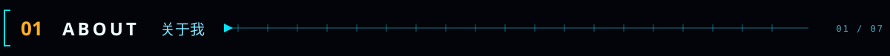

<table>
<tr>
<td width="58%" valign="top">

```console
$ whoami
Tan Ee Xin — Cyber Security @ APU

$ cat focus.txt
攻防安全  binary exploitation · ROP
数字取证  memory forensics · IR
AI 工程   LLM fine-tuning · n8n
全栈开发  Next.js · ASP.NET · Python

$ ls ./now
Tabiato/      CodeNection 2026 finals
MomCareAI/    postpartum care · Bedrock
SEA/          gamified C# learning
ml-threat/    ML threat-detection SLR
```

<p><b>一句话 · In one line</b></p>
<p>我是一名走安全方向的大学生：白天写全栈和 AI，晚上拆二进制。</p>
<p><i>A security-track undergraduate who builds full-stack and AI by day, and takes binaries apart by night.</i></p>

</td>
<td width="42%" valign="top">


</td>
</tr>
</table>

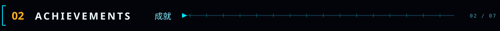

<p align="center">
  <a href="https://github.com/eexin/GroupName-CodeNection-Tabiato-">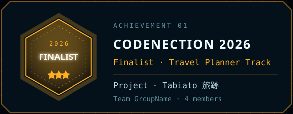</a>
  <a href="https://github.com/eexin/MomCareAI">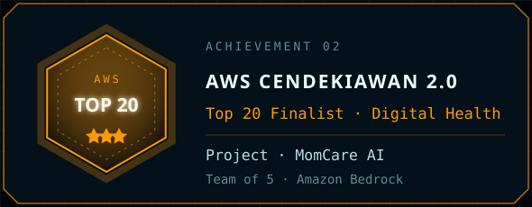</a>
</p>

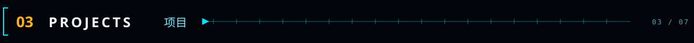

<p align="center">
  <a href="https://github.com/eexin/GroupName-CodeNection-Tabiato-">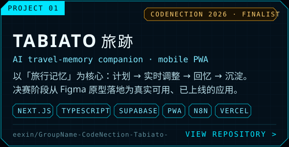</a>
  <a href="https://github.com/eexin/MomCareAI">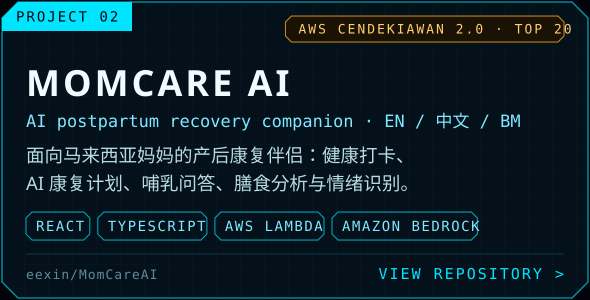</a>
</p>

<p align="center">
  <a href="https://group-name-code-nection-tabiato.vercel.app">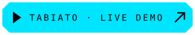</a>
</p>

<p align="center">
  <a href="https://github.com/eexin/Syntax-Error-Academy">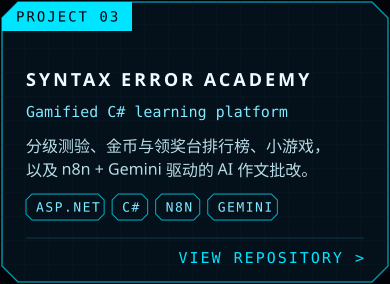</a>
  <a href="https://github.com/eexin/MathQuest">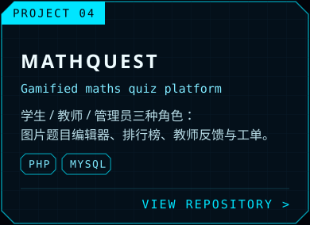</a>
  <a href="https://github.com/eexin/Diploma-Python-Assignment-Project">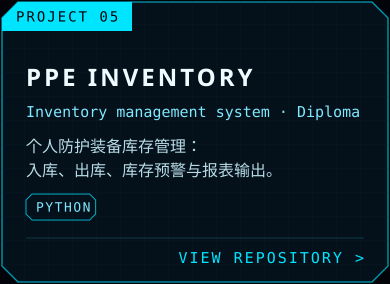</a>
</p>

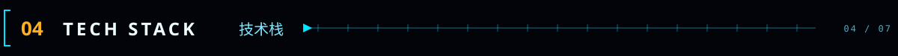

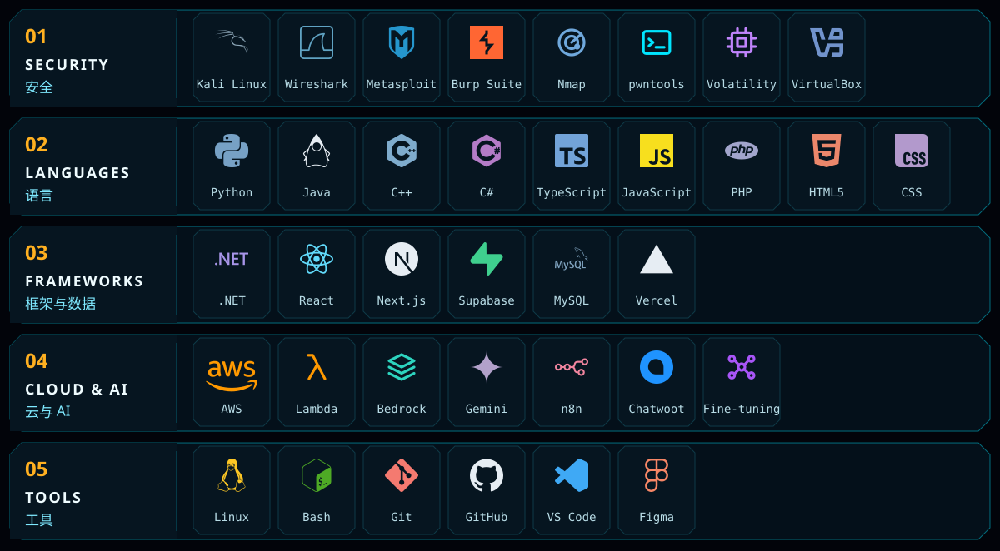

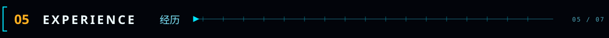

<table>
<tr><th width="16%">时间 · Period</th><th width="30%">角色 · Role</th><th width="54%">内容 · Highlights</th></tr>
<tr>
<td align="center"><b>2026</b></td>
<td><b>CodeNection 2026</b><br/><sub>Finalist · Travel Planner Track</sub></td>
<td>作为 4 人团队 GroupName 的一员打造 Tabiato 旅跡 —— 以「旅行记忆」为核心的 AI 旅行伴侣，覆盖记忆旅程、实时自适应行程调整与社群分享。决赛阶段将 Figma 原型落地为 Next.js + Supabase 的移动端 PWA，AI 流程走自托管 n8n，并部署上线。</td>
</tr>
<tr>
<td align="center"><b>2026</b></td>
<td><b>AWS CendekiAwan 2.0</b><br/><sub>Top 20 Finalist · Digital Health</sub></td>
<td>全国高校赛进入 Top 20 决赛；共同打造 MomCare AI，设计 PartyRock 多组件条件提示架构，实现个性化康复计划、情绪识别与三语输出，并向 AWS 评委陈述技术架构与落地规划。</td>
</tr>
<tr>
<td align="center"><b>2025</b></td>
<td><b>IT Intern</b><br/><sub>Mampu AI</sub></td>
<td>为 2–3 个客户项目微调 LLM，提升回答准确率与上下文相关性；开发并部署 LLM 幻觉检测 API；构建支持文件上传与 Chatwoot API 集成的 CRM 网页组件；用 n8n + WhatsApp 实现自动化监控告警；支持聊天机器人上线测试与调优。</td>
</tr>
<tr>
<td align="center"><b>2025 –<br/>Present</b></td>
<td><b>BSc (Hons) Computer Science</b><br/><sub>Cyber Security · APU</sub></td>
<td>道德黑客与事件响应、内存取证、计算理论、数据结构、人机交互；课余投入二进制利用与 CTF。</td>
</tr>
<tr>
<td align="center"><b>2023 –<br/>2025</b></td>
<td><b>Diploma in ICT</b><br/><sub>Software Engineering · APU</sub></td>
<td>HTML / Python / Java 项目开发，MySQL 数据库集成，Figma UI/UX 设计，低代码开发，并打下网络与 AI 基础。</td>
</tr>
</table>

<p align="center"><sub>Asia Pacific University of Technology &amp; Innovation　·　Degree CGPA 3.49　·　Diploma CGPA 3.41</sub></p>

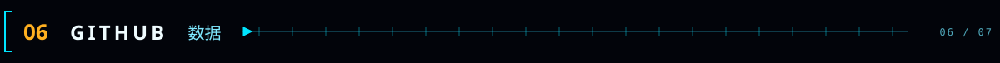

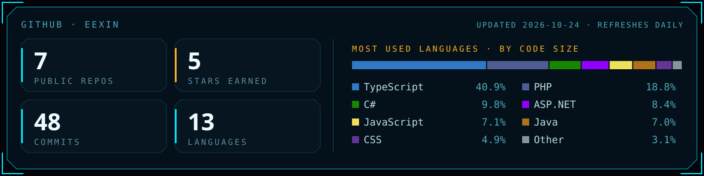


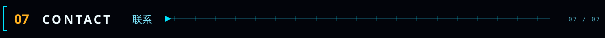

<div align="center">

想聊安全、CTF、AI，或者有实习机会 —— 欢迎直接联系。<br/>
<sub><i>Open to conversations about security, CTF and AI — and to internship opportunities.</i></sub>

<br/>

<a href="mailto:conan.tan111@gmail.com"></a>
<a href="https://www.linkedin.com/in/ee-xin-tan-01bab2282"></a>
<a href="https://github.com/eexin">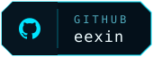</a>

<br/><br/>


</div>
